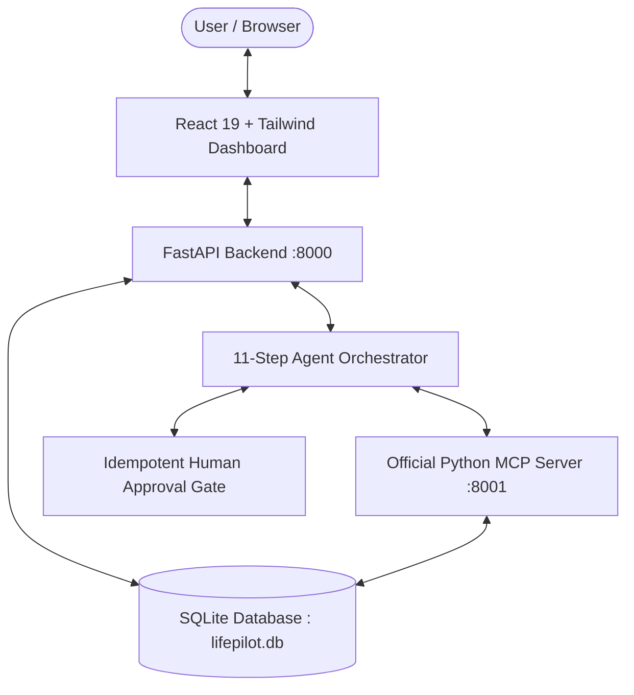

# LifePilot AI

> **Tagline:** More than answers. AI that gets things done.  
> **Primary Hackathon Track:** Alexa+  
> **Project Type:** Action-Oriented AI Productivity Assistant & Dashboard

[](#running-automated-tests)
[](https://python.org)
[](https://react.dev)
[](https://fastapi.tiangolo.com)
[](https://modelcontextprotocol.io)

---

## 1. Project Overview

**LifePilot AI** helps students and professionals manage their tasks, schedules, notes, deadlines, and study plans through natural-language instructions.

Traditional conversational chatbots answer questions but stop short of taking real action. LifePilot AI goes further:
1. **Identifies Intent**: Parses deadlines, priorities, subjects, and durations from plain speech or text.
2. **Plans Multi-Step Actions**: Creates structured execution plans with inspectable steps.
3. **Calls MCP Tools**: Invokes 14 official Model Context Protocol (MCP) tools connected to the database.
4. **Enforces Human Approval**: Consequential operations (such as creating calendar events or scheduling multi-session study plans) require explicit user approval.
5. **Executes & Verifies**: Executes approved mutations, queries the database to verify the persisted records, and explains the outcome truthfully.

---

## 2. Key Features

- **Personalized SaaS Dashboard**: Overview of pending tasks, completed records, calendar commitments, Recharts productivity visualization, priority queue, and recent agent telemetry.
- **AI Productivity Assistant**: Conversational chat interface featuring structured plan cards, tool invocation traces, suggested prompts, voice input demo, and approval gating.
- **Task Management (Full CRUD)**: Create, edit, complete, reopen, delete, filter by status/priority, search, and view overdue assignments.
- **Algorithmic Prioritization**: Rule-based priority scoring evaluating deadline proximity, priority multipliers, and quick-win bonuses with transparent reasoning.
- **Calendar & Free-Time Calculator**: Internal database calendar with overlap detection and automated gap discovery for deep work blocks.
- **Notes Hub & Task Extraction**: Searchable markdown notes with automated checklist parsing (`[ ]`) and action verb conversion into task queue items.
- **Exam & Study Planner**: Progressively schedules conflict-free study sessions across available days leading up to an exam.
- **Agent Runs & Execution History**: Audit trail tracking agent states (`pending`, `planning`, `awaiting_approval`, `executing`, `completed`, `cancelled`, `failed`).
- **Official Python MCP Server**: 14 validated tools operating via Streamable HTTP (MCP spec `2025-11-25`).
- **Browser Voice Input Demo**: Web Speech API integration with real-time listening indicator, permission handling, and text fallback.

---

## 3. Technology Stack

### Frontend
- **Core**: React 19, TypeScript, Vite 5
- **Styling**: Tailwind CSS (Dark navy sidebar `#0B132B`, light workspace, blue primary actions)
- **Navigation**: React Router DOM v7
- **Icons & Charts**: Lucide React, Recharts
- **Voice Demo**: Web Speech API (`SpeechRecognition` / `webkitSpeechRecognition`)

### Backend
- **Core Framework**: FastAPI, Pydantic v2
- **Database & ORM**: SQLAlchemy 2, Alembic
- **Default Database**: SQLite (`lifepilot.db`) with zero-config setup; PostgreSQL compatible
- **Testing**: Pytest, Pytest-Asyncio, HTTPX TestClient

### AI & Protocol Layer
- **MCP Server**: Official Python MCP SDK (`mcp.server.mcpserver.MCPServer`)
- **Transport**: Streamable HTTP and Server-Sent Events (SSE)
- **Specification**: Version `2025-11-25`
- **Default Provider**: Deterministic Demo Provider (backed by real database queries and algorithmic reasoning)
- **Optional Real AI**: Configurable for OpenAI, Anthropic Claude, or AWS Bedrock via environment variables

---

## 4. Architecture Diagram



---

## 5. Prerequisites

- **Python**: Version `3.10` or higher (Tested on Python 3.13)
- **Node.js**: Version `18.0` or higher (Tested on Node v20.16.0)
- **Git** (optional)

---

## 6. Installation & Quick Start

### Step 1: Clone or Navigate to the Workspace
```bash
cd "Amazon Devpost Challenge Code file"
```

### Step 2: Set Up Backend
```bash
# Create virtual environment (if not already present)
python -m venv venv

# Activate virtual environment
# Windows:
.\venv\Scripts\activate
# macOS/Linux:
source venv/bin/activate

# Install backend dependencies
pip install -r backend/requirements.txt
```

### Step 3: Set Up Frontend
```bash
cd frontend
npm install
cd ..
```

### Step 4: Environment Configuration
Copy `.env.example` to `.env`:
```bash
cp .env.example .env
```
*Note: No paid API keys or cloud credentials are required to run the full application and all three demonstration workflows.*

---

## 7. Running the Application

### 7.1 Start the Backend Server
From the project root with the virtual environment activated:
```bash
.\venv\Scripts\python -m uvicorn backend.app.main:app --host 127.0.0.1 --port 8000 --reload
```
- API Base: `http://localhost:8000/api`
- Interactive Swagger Docs: `http://localhost:8000/docs`
- Health Endpoint: `http://localhost:8000/health`

### 7.2 Start the Frontend Development Server
In a separate terminal:
```bash
cd frontend
npm run dev
```
Open `http://localhost:5173` in your browser.

---

## 8. Running Automated Tests

### 8.1 Backend Test Suite (14 Tests)
```bash
.\venv\Scripts\python -m pytest backend/tests -v
```
All 14 tests pass, covering:
- Health and Root endpoints
- Task CRUD, completion, reopening, and multi-factor prioritization
- Calendar CRUD, overlap detection, and free-time discovery
- Note CRUD, summarization, and task extraction
- Multi-session exam study planning
- Approval execution, database verification, duplicate idempotency, and cancellation
- Workflow A (Prioritize tasks)
- Workflow B (Find free time & approve)
- Workflow C (Exam study plan & approve)
- MCP tool registry, health report, and direct tool execution

### 8.2 Frontend Production Build Check
```bash
cd frontend
npm run build
```
Builds the clean production bundle with 0 TypeScript errors.

---

## 9. Demonstration Workflows

### Workflow A: Task Prioritization
1. Go to **AI Assistant** (`/chat`).
2. Enter or click: `"Show my pending tasks and prioritize them."`
3. **Outcome**: The agent queries active tasks from your database, computes multi-factor urgency scores, explains the reasoning transparently, and highlights what to do first.

### Workflow B: Find Free Time & Human Approval
1. In Chat, enter: `"Find two free hours tomorrow for project work."`
2. **Outcome**: The agent analyzes tomorrow's commitments, discovers an open 2.5-hour block, and stages an **Approval Card**.
3. Click **Approve & Persist**: The calendar event is saved, verified against the database, and confirmed. Check the **Schedule** tab to view your scheduled session!

### Workflow C: Conflict-Free Exam Roadmap
1. In Chat, enter: `"Plan my week around my exams."`
2. **Outcome**: The agent calculates days until the exam, avoids all calendar conflicts, and proposes 4 structured study sessions.
3. Review the sessions and click **Approve & Persist** to save them directly into the calendar.

---

## 10. Real vs. Simulated Integrations

To adhere to hackathon transparency:
- **Internal Database Calendar**: Real, persistent local SQLite/PostgreSQL database. Not falsely claimed to be synced with external Google or Outlook calendars.
- **Model Context Protocol (MCP)**: Genuine implementation using official Python MCP SDK (`mcp.server.mcpserver.MCPServer`) and Streamable HTTP.
- **Browser Voice Input**: Uses standard Web Speech API in supported browsers. Labelled as a browser voice demo rather than official Alexa hardware.
- **Deterministic Demo Provider**: Clearly labelled as deterministic rule-based orchestration over real database tools when no paid LLM keys are configured.

---

## 11. Documentation Index

- [Architecture Guide](docs/architecture.md)
- [REST API Specification](docs/api.md)
- [MCP Tools Documentation](docs/mcp-tools.md)
- [Testing & Verification Guide](docs/testing.md)
- [Hackathon Demo Script](docs/demo-script.md)

---

## 12. License & Attribution

Built for the **Amazon Devpost Challenge (Alexa+ Track)**.  
LifePilot AI — *More than answers. AI that gets things done.*
