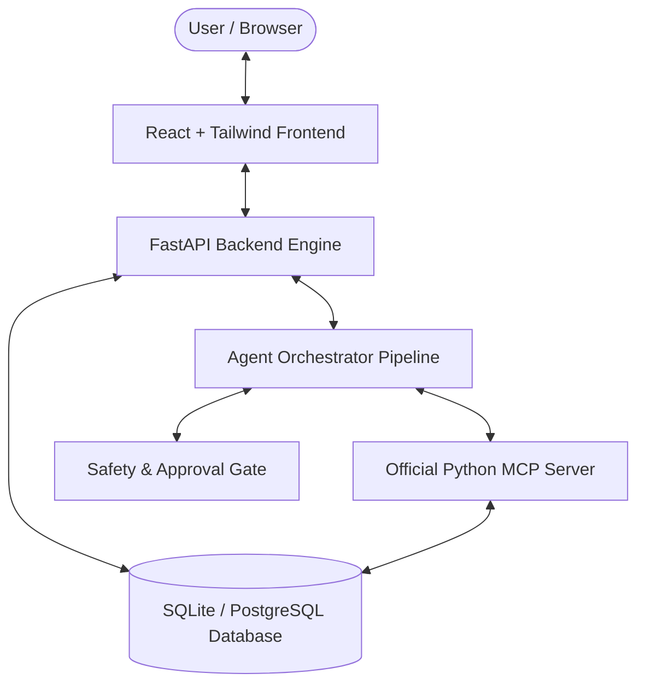

# LifePilot AI — System Architecture

## 1. High-Level Overview

LifePilot AI is an action-oriented AI productivity assistant and dashboard built for the **Alexa+** hackathon track. Unlike conventional conversational chatbots that merely answer questions or simulate tools, LifePilot AI integrates a structured 11-step agent execution pipeline with the official Python Model Context Protocol (MCP) SDK, human approval gates for consequential operations, and a real SQLite / PostgreSQL database.

## 2. Component Layers

### 2.1 Frontend Presentation Layer
- **Framework**: React 19, TypeScript, Vite.
- **Styling**: Tailwind CSS with custom design tokens (Dark navy sidebar `#0B132B`, light workspace, blue primary actions, rounded cards, accessible focus rings).
- **Icons & Visualizations**: Lucide React icons, Recharts area and density charts.
- **Voice Input Demo**: Web Speech API integration with real-time listening indicator, permission handling, and text fallback. Clearly labelled as a browser voice demo rather than official Alexa hardware.

### 2.2 Backend Service & API Layer
- **Framework**: FastAPI with Pydantic v2 validation.
- **ORM & Data Storage**: SQLAlchemy 2 with SQLite for zero-config local development and PostgreSQL compatibility.
- **Routers**:
  - `/api/tasks`: Full Task CRUD and algorithmic multi-factor prioritization.
  - `/api/calendar`: Internal calendar, overlap detection, free-time gap discovery.
  - `/api/notes`: Knowledge repository, summarization, checklist task extraction.
  - `/api/study-planner`: Multi-session exam roadmap generator.
  - `/api/chat`: 11-step agent execution pipeline and conversation history.
  - `/api/approvals`: Idempotent action approvals and cancellation audit trail.
  - `/api/agent`: Telemetry, plan step viewer, tool invocation logs.
  - `/api/tools`: Tool registry, health diagnostic endpoint, live execution tester.
  - `/api/seed`: Realistic student/professional seed data management.

### 2.3 Agent Orchestration & Safety Layer
The agent pipeline follows an explicit 11-step stateful workflow:
1. **Receive User Prompt**: Ingest natural language query.
2. **Intent & Parameter Extraction**: Extract dates, durations, subjects, priorities.
3. **Data Retrieval**: Fetch active tasks, calendar commitments, and notes.
4. **Structured Action Planning**: Formulate ordered steps.
5. **Tool Call Formulation**: Prepare tool parameters according to MCP schema.
6. **Safety & Consequential Analysis**: Classify mutations as read-only vs. consequential.
7. **Human Approval Gating**: Stage approval request with title, affected table, and parameters.
8. **Tool Invocation**: Call MCP tool or internal service.
9. **Persistence & Verification**: Read persisted record back from DB to verify result.
10. **Telemetry & Audit Logging**: Record agent run with explicit status (`pending`, `planning`, `awaiting_approval`, `executing`, `completed`, `cancelled`, `failed`).
11. **Truthful Explanation**: Deliver transparent reasoning explaining why tasks were prioritized or time slots proposed.

### 2.4 Model Context Protocol (MCP) Server
- **Implementation**: Built using the official Python MCP SDK (`mcp.server.mcpserver.MCPServer`).
- **Transport**: Streamable HTTP and SSE following specification version **2025-11-25**.
- **Shared Service Layer**: All 14 MCP tools map directly to the same backend services and database models as the REST API, preventing business logic duplication.

### 2.5 Security & Data Integrity
- Zero secrets committed to frontend bundle or source control.
- Idempotency tokens on approval executions prevent duplicate records from rapid clicks.
- Internal calendar events are explicitly presented as internal records, never falsely claimed to be synced with Google or Microsoft accounts without active credentials.
